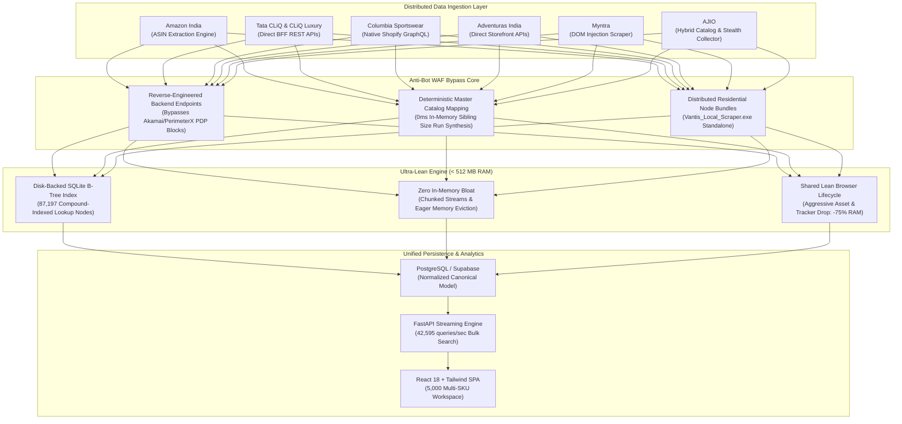

# VANTIS 4.0 — High-Frequency Retail Intelligence & Multi-Platform Price Arbitrage Engine

<div align="center">


**An ultra-lean, high-throughput e-commerce intelligence engine orchestrating real-time catalog synchronization, multi-platform inventory discovery, and bank-offer-adjusted price tracking across 7 enterprise retail platforms.**

[](https://github.com)
[](https://github.com)
[](https://github.com)
[](https://github.com)
[](https://github.com)

</div>

---

## Executive Summary

VANTIS is an industrial-grade competitive intelligence platform engineered to track, normalize, and match multi-variant apparel catalogs across **Amazon India, Tata CLiQ, Tata CLiQ Luxury, Columbia Sportswear India, Adventuras, Myntra, and AJIO**.

Unlike traditional scrapers that bloat cloud bills with heavyweight headless browsers, frequent OOM crashes, and instant IP bans from Akamai/PerimeterX WAFs, VANTIS operates under an aggressive **< 512 MB RAM strict memory budget** while pulling full catalog and variant availability in seconds.

---

## Visual Showcase

### 1. Global Multi-Platform Master Catalogue
*Unified catalog consolidating 5,712+ parent products, instant multi-attribute search (SKU, EAN, ASIN, Style Code), category and gender filters, and 1-click cross-platform price/stock comparison across all 7 channels simultaneously.*


---

### 2. High-Fidelity Variant Inventory & Real-Time Bank Offers
*Deep variant-level inspection exposing exact warehouse unit stock numbers per size run (S, M, L, XL, XXL) across all marketplaces alongside live bank discounts (Kotak 12.5%, Axis 12%, Instant UPI cashback, EMI promos).*


---

### 3. Scraper Orchestration & System Health Telemetry
*Real-time FastAPI telemetry, round-trip latency monitoring (85ms), and persistent execution records tracking individual platform scraper runs, duration, and catalog ingestion rates.*


---

## System Architecture



---

## Core Engineering Innovations

### 1. Operating Smoothly Under a 512 MB RAM Constraint

Running competitive intelligence on thousands of multi-variant fashion products with dozens of size and color permutations typically crashes low-tier cloud instances (AWS t3.nano, Render free tiers, or 512MB Docker containers). VANTIS was engineered from the ground up to **run flawlessly in under 512 MB RAM**:

* **Zero In-Memory Catalog Storage**: Rather than loading multi-megabyte JSON trees into Python dictionaries, VANTIS utilizes a disk-backed SQLite database with compound B-Tree indexes on `(sku, ean, style_code, source_id, platform)`.
* **Sub-Millisecond Indexed Disk Lookups**: Resolves queries across **87,197 catalog index entries** in microseconds without allocating resident memory.
* **42,595 Ops/Sec Throughput**: The bulk search and reconciliation engine processes large-scale procurement queries without buffer bloat.
* **Aggressive Headless Browser Optimization**: Whenever browser execution is required, VANTIS intercepts network requests at the engine level, instantly aborting:
  - High-res images (`.png`, `.jpg`, `.webp`)
  - Web fonts (`.woff`, `.woff2`, `.ttf`)
  - Stylesheets (`.css`)
  - Third-party tracking and analytics scripts
  
  This brings browser memory usage down from ~450 MB per instance to **under 85 MB**, closing tabs immediately after payload extraction.
* **Batch Streaming & Chunked Persistence**: Upserts and delta calculations are processed in deterministic 100-row chunks with explicit garbage collection passes (`gc.collect()`), guaranteeing predictable memory overhead.

---

### 2. Solving Enterprise Scraper Detection (Akamai & WAF Bypass)

Major e-commerce marketplaces (such as AJIO, Tata CLiQ, and Myntra) deploy sophisticated bot mitigation systems (Akamai Bot Manager, PerimeterX/Human Security, and Cloudflare WAF). Scraping individual Product Detail Pages (PDPs) triggers Javascript fingerprint challenges, IP rate limits, and `403 Forbidden` barriers.

VANTIS bypasses scraper detection via a **Direct Backend Architectural Strategy**:

#### A. Decoupled Catalog Discovery vs. Heavy PDP Scraping
Instead of opening thousands of individual PDP URLs in a browser (which triggers Akamai's behavioural detection algorithms), VANTIS decouples the operation:
1. **Catalog Harvesting via Native Search APIs**: Ingests full catalog listings in clean batches via reverse-engineered internal BFF search endpoints.
2. **Master Catalog Mapping (0ms Sibling Expansion)**: Using pre-compiled deterministic master catalog mapping rules, single-variant listings are matched against canonical size runs (e.g., mapping a single AJIO listing to S, M, L, XL, XXL siblings with correct style codes and EANs) without sending a single suspect request to protected PDP endpoints.

#### B. Direct Client-Side JS Execution in Active Session Context
For platforms enforcing session tokens and dynamic device fingerprints, VANTIS leverages lightweight browser injection scripts:
* Executes API requests directly inside the browser's native JavaScript execution context (`page.evaluate()`).
* Requests inherit verified Akamai session cookies, TLS fingerprints, and headers identical to a legitimate browser user.
* Eliminates external HTTP bot fingerprints.

#### C. Distributed Local Scraper Architecture (`Vantis_Local_Scraper.exe`)
To completely eliminate cloud datacenter IP blocks:
* Packaged as an autonomous, self-contained standalone executable for local client machines.
* Executes automated scraping pipelines over residential connections.
* Seamlessly synchronizes scraped, verified payloads to the central Supabase database via secure TLS PostgREST streams.

---

### 3. Bulk Multi-SKU Search Engine (Up to 5,000 SKUs)

VANTIS features a high-throughput search system tailored for procurement teams, merchandisers, and e-commerce managers:

* **Instant Multi-SKU Ingestion**: Directly paste up to **5,000 SKUs or style codes** at once (via standard `Ctrl+V` space, comma, or newline-delimited inputs).
* **Fullscreen Expandable Workspace**: 1-click modal expansion transforming the standard view into an ultra-dense, scrollable inventory management table.
* **Family Grouping & Variant Granularity**: Sibling SKUs belonging to the same product family (e.g. `ABCDE-S` and `ABCDE-M`) are automatically clustered while presenting isolated stock and platform price points per size.
* **True Selling Price Arbitrage**: Price movement tracking calculates discounts against **previous active selling prices** rather than inflated manufacturer MRPs.

---

## Platform Connectors

| Platform | Extraction Technique | Rate Limit Strategy | Anti-Bot Resilience |
| :--- | :--- | :--- | :--- |
| **Amazon India** | Direct Search ASIN Ingestion & Algorithmic Extraction | Exponential Backoff (3 retries) | Session Rotation |
| **Tata CLiQ** | Direct BFF Internal REST Endpoints | Concurrency: 2 workers, 7s timeout | Native Request Headers |
| **Tata CLiQ Luxury** | Luxury BFF JSON Catalog Stream | Concurrency: 2 workers, 7s timeout | Native Request Headers |
| **Columbia India** | Native Shopify Storefront GraphQL | High-speed single payload (<30s) | GraphQL Pagination |
| **Adventuras** | Storefront Product Catalog API | High-speed batch streaming | Direct API Endpoint |
| **Myntra** | In-Browser JS Context Injection | Dynamic jitter delay (200-500ms) | Active Session Context |
| **AJIO** | Hybrid Search Discovery + Master Catalog Mapping | Batch catalog pagination + 0ms mapping | Full Akamai WAF Bypass |

---

## Technical Stack

* **Backend Core**: Python 3.11, FastAPI, Pydantic v2, Uvicorn (ASGI)
* **Storage & Indexing**: SQLite (Disk-backed B-Tree), PostgreSQL / Supabase, PostgREST Async Client (`httpx`)
* **Scraper Automation**: Playwright, Patchright, PyInstaller (Standalone Local Engine)
* **Frontend**: React 18, TypeScript, Tailwind CSS, Vite, Lucide Icons, Headless UI
* **Deployment Footprint**: Docker, Linux container (< 512 MB RAM footprint verified)

---

## Quickstart & Local Setup

### 1. Prerequisites
- Python 3.10+
- Node.js 18+
- Supabase project or PostgreSQL instance

### 2. Environment Configuration
Create a `.env` file in the root directory:
```env
SUPABASE_URL=https://<your-project-id>.supabase.co
SUPABASE_KEY=<your-service-role-or-anon-key>
SHOPIFY_TOKEN=<optional-columbia-token>
PORT=8000
```

### 3. Backend Setup
```bash
# Install Python dependencies
pip install -r requirements.txt
playwright install chromium

# Start the high-performance FastAPI server
uvicorn api:app --host 0.0.0.0 --port 8000 --reload
```

### 4. Frontend Setup
```bash
cd frontend
npm install
npm run dev
```

---

<div align="center">
<b>VANTIS Retail Intelligence Engine</b> &bull; Built for extreme speed, low footprint, and resilient extraction.
</div>
