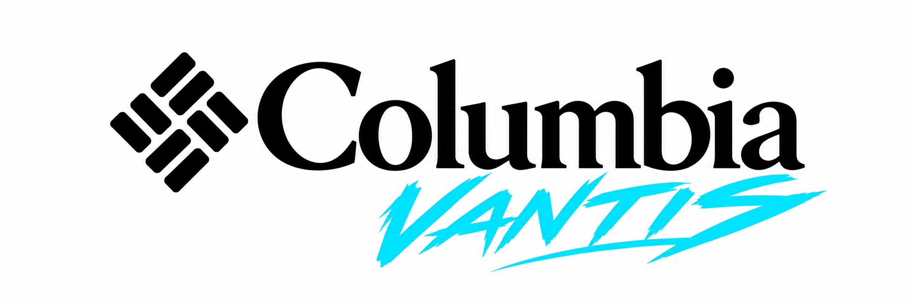
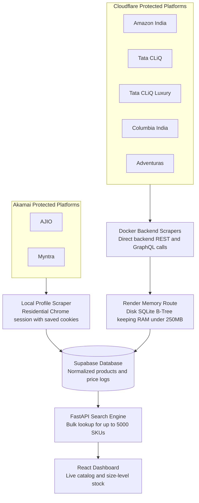
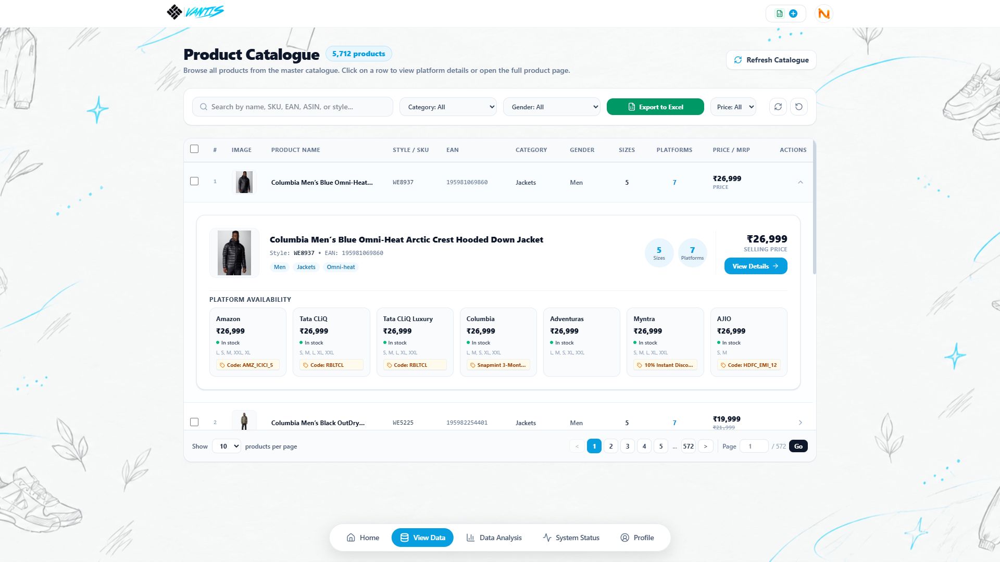
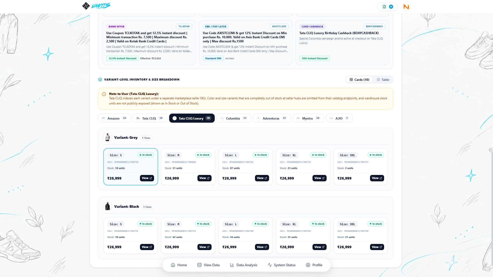
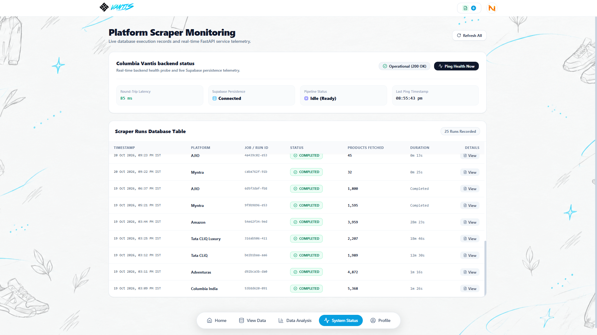

# Columbia Vantis

<div align="center">



</div>

---

## What we made

Columbia Sportswear in India is distributed exclusively by Chogori India Retail Limited. When you manage an outdoor and sportswear brand of this scale, your items end up on every major shopping portal in the country: Amazon India, Tata CLiQ, Tata CLiQ Luxury, Myntra, AJIO, Adventuras, and your own official Columbia India website.

Every single day, these platforms update prices, launch bank offers like instant discounts on HDFC or Kotak, run flash deals, or run out of stock in specific sizes. Trying to keep track of 5,000 products and over 25,000 size and color options by hand is practically impossible.

We created Columbia Vantis to fix that. It tracks our catalog across all seven platforms, monitors live inventory down to the exact unit count in each warehouse, calculates what shoppers actually pay after bank discounts, and flags price changes as soon as they happen.

---

## System Architecture



---

## The unique problems we faced

When you try to pull data from major shopping portals at this scale and host it on real cloud infrastructure, you hit walls fast. Here is how we solved our biggest hurdles.

### 1. Surviving on a strict 512 MB RAM budget on Render

We host the backend on Render under a 512 MB memory limit. If you launch standard Chrome or try to load thousands of product listings into Python memory at once, the server runs out of memory and crashes instantly.

We kept our total memory footprint under 250 MB using three decisions:
* Disk-backed SQLite indexing instead of RAM: We avoid keeping thousands of products in application memory. Instead, we write to an on-disk SQLite database with compound B-Tree indexes. Searches by SKU, barcode, or style code read directly from disk in microseconds.
* Blocking heavy browser assets: When a scraper needs a browser, we intercept network requests and block all images, web fonts, CSS stylesheets, and tracking scripts before they download. That drops Chrome memory consumption from 450 MB down to under 85 MB per tab.
* Streaming in 100-item chunks: We write data to the database in batches of 100 items and call Python garbage collection immediately after, keeping memory flat throughout the entire run.

---

### 2. Five Cloudflare-protected scrapers using direct backend APIs on Docker

Five of our sources run behind Cloudflare or basic bot protection: Amazon India, Tata CLiQ, Tata CLiQ Luxury, Columbia Sportswear India, and Adventuras.

Typical scrapers open web pages, wait for JavaScript to render, and parse the HTML. That approach is slow, burns through CPU, and triggers Cloudflare verification screens.

Instead, we reverse-engineered the internal APIs that power their mobile apps and web frontends. We skip the HTML entirely and pull structured JSON directly through lightweight HTTP requests and injected JavaScript. It runs ten times faster, uses almost no CPU or memory, avoids bot screens, and deploys cleanly in our Docker container.

---

### 3. The Akamai wall on AJIO and Myntra

AJIO and Myntra rely on Akamai Bot Manager, which is much more aggressive:
* Requests coming from cloud datacenters like AWS, Render, or DigitalOcean get blocked on arrival with 403 Forbidden errors.
* Clicking into every individual size option on thousands of product pages triggers Akamai rate limits and CAPTCHAs.

Here is how we bypassed it without paying for expensive rotating proxies:
* Standalone local executable: We packaged our scraper into Vantis_Local_Scraper.exe, which runs on a local machine using a standard home residential internet connection.
* Persistent Chrome profile: The runner uses an existing Chrome profile with valid login cookies. Because the connection uses a residential IP and authentic browser fingerprints, Akamai treats it like a real human browsing the site.
* In-session JavaScript injection: Once the tab is open, the runner injects JavaScript into the active session to query catalog endpoints directly using existing cookies.
* Master catalog sibling mapping: Instead of loading thousands of product detail pages to check sizes, we take the base product and map it against our master catalog rules. We generate the full size range from small to double extra large, complete with style codes and barcodes, in zero milliseconds. Clean data then uploads straight to our cloud database on Supabase.

---

## App Walkthrough & Screenshots

### 1. Master Product Catalogue

Browse all 5,712 products from our master catalog. You can search by SKU, barcode, Amazon ASIN, or style code, filter by category or gender, and inspect side by side prices across all seven platforms.



---

### 2. Size-Level Stock & Bank Offer Breakdown

Selecting a product reveals real-time warehouse stock counts for every size from S to XXL, shows which stores have inventory, and factors in live bank promotions like 12.5% off on Kotak or 12% on Axis to calculate what buyers actually pay.



---

### 3. Live Scraper Telemetry & Monitoring

A dedicated monitoring view displaying the status of the FastAPI service, database round-trip response time, and a full history of recent scraper runs with item counts and durations.



---

## Previous Build Work

In earlier versions of this project, we focused on image recognition and multi-platform product matching. We built a system to scan product photos across all marketplaces and trained a custom computer vision model using CLIP, DINOv2, and price signals on a 1,000-product golden dataset. The model matched duplicate products across stores and could predict which platform an image came from with an 85% test accuracy score.

---

## Tech Stack

* Backend: Python 3.11, FastAPI, Uvicorn, Pydantic v2
* Database: PostgreSQL on Supabase, SQLite B-Tree for local indexing
* Automation: Playwright, Patchright, PyInstaller
* Frontend: React 18, TypeScript, Vite, Tailwind CSS, Lucide Icons
* Deployment: Docker, Render

---

## Getting Started Locally

### 1. Clone and Configure
```bash
git clone https://github.com/Kartikey5853/Columbia_4.0.git
cd Columbia_4.0
```

Create a `.env` file in the root folder:
```env
SUPABASE_URL=https://<your-project-id>.supabase.co
SUPABASE_KEY=<your-supabase-key>
PORT=8000
```

### 2. Run the Backend
```bash
pip install -r requirements.txt
playwright install chromium
uvicorn api:app --host 0.0.0.0 --port 8000 --reload
```

### 3. Run the Frontend
```bash
cd frontend
npm install
npm run dev
```

---

## Contributors

* Raj ([@Raj-dev18](https://github.com/Raj-dev18)): Built the local scraper runner, packaging, and half of the frontend and scraper development.
