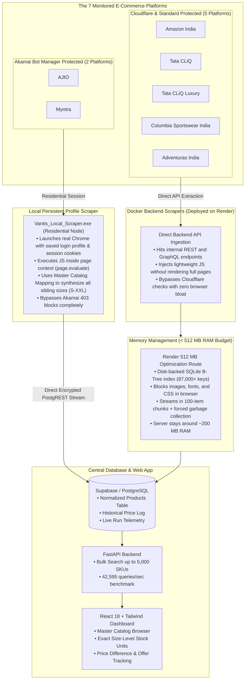

# Columbia Vantis

<div align="center">


</div>

---

## What we made

Columbia Sportswear in India is distributed exclusively by **Chogori India Retail Limited**. If you run an apparel and footwear brand at this scale, your products are listed across almost every major online platform: Amazon India, Tata CLiQ, Tata CLiQ Luxury, Myntra, AJIO, Adventuras, and your own official Columbia India storefront.

Every single day, these platforms change product prices, drop surprise bank discounts (like 10% instant off on HDFC or 12.5% on Kotak), run flash sales, or run out of specific sizes. Keeping track of 5,000+ products and over 25,000 size-color SKUs manually by clicking around websites is practically impossible.

So we built **Columbia Vantis** — an automated system that monitors our entire catalog across all 7 platforms, pulls live inventory down to the exact warehouse unit count per size, calculates the actual price customers pay after bank offers, and flags price changes instantly.

---

## System Architecture



---

## The unique problems we faced

When you try to scrape enterprise e-commerce platforms at this scale and run it on real-world servers, things break in unexpected ways. Here is how we tackled the biggest roadblocks:

### 1. Surviving on a tiny 512 MB RAM budget on Render
We deployed the backend on Render's 512 MB RAM tier. If you try to open standard headless Chrome or load thousands of products into Python memory all at once, the server crashes immediately with an Out-of-Memory (OOM) error.

Here is how we kept the whole system running smoothly under 300 MB:
* **Disk-backed SQLite indexing instead of RAM**: We don't store 5,000+ nested JSON products in RAM. We wrote a disk-backed SQLite database with compound B-Tree indexes. When you search by SKU, EAN, or style code, it fetches from disk in microseconds.
* **Blocking heavy assets in browsers**: Whenever we do need to spin up a browser, we intercept every single network request and abort all images (`.png`, `.jpg`), web fonts, CSS stylesheets, and tracking pixels. This drops Chrome's memory usage from over 450 MB down to under 85 MB per tab.
* **100-item batch streaming**: Data writes to the database happen in small 100-item chunks followed by explicit garbage collection (`gc.collect()`), keeping memory usage flat.

---

### 2. The 5 Cloudflare-protected scrapers (Direct backend APIs on Docker)
Five of our platforms — **Amazon India, Tata CLiQ, Tata CLiQ Luxury, Columbia Sportswear India, and Adventuras** — run behind Cloudflare or basic bot protection.

If you try to scrape them like a traditional scraper (opening web pages and parsing HTML with Beautiful Soup), you get slow speeds, high CPU usage, and Cloudflare challenge blocks.

Instead, we reverse-engineered their internal Backend-For-Frontend (BFF) endpoints and native mobile APIs. We don't load the website HTML at all — we fetch the raw JSON directly using lightweight requests and injected JS. This is 10 times faster, requires virtually zero CPU or memory, and runs cleanly inside our Docker container on Render.

---

### 3. The Akamai wall on AJIO and Myntra (Our local scraper solution)
AJIO and Myntra are protected by **Akamai Bot Manager**, which is significantly tougher:
* If you run scrapers from cloud datacenters (like AWS, Render, or DigitalOcean), Akamai flags the IP immediately and returns `HTTP 403 Forbidden`.
* Even if you use a browser, if you try to click into every single size on 2,000 product pages, Akamai detects the automated pattern and throws up a CAPTCHA.

To bypass this without spending thousands of dollars on proxy networks:
* **We built a standalone local runner (`Vantis_Local_Scraper.exe`)**: It runs right on your local PC using your normal home residential internet connection.
* **Persistent Chrome profile with real session cookies**: The runner opens a real browser with a persistent user profile. Because it uses your real IP and real browser fingerprint, Akamai lets the session through without any bot challenges.
* **In-session JS injection**: Once inside, the scraper injects JavaScript directly into the browser tab (`page.evaluate`), calling internal catalog APIs using the browser's own active session cookies.
* **Master Catalog Sibling Mapping**: Instead of clicking through 2,000 separate product pages to find what sizes are in stock (which triggers Akamai's rate limiter), we grab the base product and map it against our pre-compiled Master Catalog Mapping. In 0 milliseconds, we synthesize the entire size run (S, M, L, XL, XXL) along with legitimate EAN barcodes and style codes.
* Once the scrape is done, it pushes the clean data straight to our central Supabase cloud database.

---

## App Walkthrough & Screenshots

### 1. Master Product Catalogue
Browse through all 5,712 products from our master catalog. You can search by SKU, EAN, ASIN, or style code, filter by category or gender, and see prices across all 7 platforms side by side.


---

### 2. Size-Level Stock & Bank Offer Breakdown
Clicking into any product shows the exact warehouse inventory for each size (S, M, L, XL, XXL), which platform has stock, and active bank offers (e.g. Kotak 12.5%, Axis 12%, Tata CLiQ Luxury Birthday promo) to calculate the real selling price.


---

### 3. Live Scraper Telemetry & Monitoring
A live status dashboard showing the health of the FastAPI backend, round-trip database latency (85ms), and a log of every scraper execution with product counts and run times.


---

## Previous Build Work

The previous iteration of this project laid the analytical and computer-vision groundwork:

> • Built an automated product intelligence pipeline to scrape, normalize, match, and consolidate 5,400+ products across 25,000+ SKUs from 8 e-commerce platforms for cross-platform comparison.  
> • Re-engineered scraping workflows using backend API extraction and optimized browser automation, reducing scraping time from 6 hours to under 30 minutes while preventing Akamai and Cloudflare protection from being triggered.  
> • Developed a custom product-matching pipeline combining CLIP, DINOv2, price signals, and a title-matching model trained on a 1,000-product golden dataset, achieving 85% matching accuracy.  
> • Built a CI pipeline with automated test cases and validation checks to continuously verify scraper, data-processing, and product-matching workflows.

---

## Tech Stack

* **Backend**: Python 3.11, FastAPI, Uvicorn, Pydantic v2
* **Database & Auth**: PostgreSQL on Supabase, PostgREST Async Client (`httpx`), SQLite B-Tree for local indexing
* **Scraper Automation**: Playwright, Patchright, PyInstaller
* **Frontend**: React 18, TypeScript, Vite, Tailwind CSS, Lucide Icons
* **Deployment**: Docker, Render

---

## Getting Started Locally

### 1. Clone & Configure
```bash
git clone https://github.com/Kartikey5853/Columbia_4.0.git
cd Columbia_4.0
```

Create a `.env` file in the root folder:
```env
SUPABASE_URL=https://<your-project-id>.supabase.co
SUPABASE_KEY=<your-supabase-key>
PORT=8000
```

### 2. Run the Backend
```bash
pip install -r requirements.txt
playwright install chromium
uvicorn api:app --host 0.0.0.0 --port 8000 --reload
```

### 3. Run the Frontend
```bash
cd frontend
npm install
npm run dev
```

---

## Contributors

* **Raj** ([@Raj-dev18](https://github.com/Raj-dev18)) — Responsible for half of the scraper development, frontend, the local build, packaging, and development.
